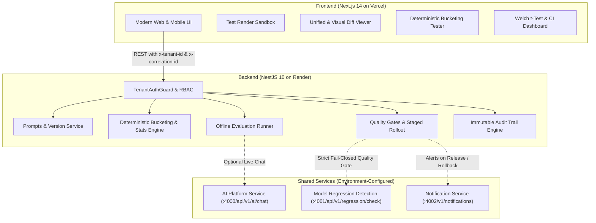

# AI Prompt Experiment & Release Manager

> Enterprise-grade full-stack platform for prompt version management, deterministic A/B testing, offline evaluation runners, automated quality gates, and staged AI releases with auditable 1-click rollbacks.

[](file:///backend)
[](file:///frontend)
[](file:///README.md)
[](file:///LICENSE)

---

## 🌟 Executive Overview

In production AI architectures, changing a prompt without formal versioning, statistical cohort testing, and automated regression verification risks silent quality degradation, latency spikes, and unexpected cost surges.

**AI Prompt Experiment & Release Manager** provides an end-to-end governance lifecycle:
1. **Immutable Prompt Versioning**: Content-addressable SHA-256 checksums, variable schema validation, template syntax sandboxing, and optimistic concurrency locking.
2. **Deterministic A/B Experiments**: Stable hashing bucketing ($0..99$) with tenant and application isolation, eliminating assignment drift across repeated subject sessions.
3. **Statistical Power & Significance**: Real-time Welch's t-test hypothesis verification ($p < 0.05$), standard error calculations, and 95% Confidence Intervals with strict sample size guardrails ($N \ge 30$).
4. **Automated Quality Gates**: Configurable pass/warn/fail thresholds for p95 latency, cost ceilings, and automated integration with external Model Regression Detection services under a strict fail-closed policy.
5. **Staged AI Rollouts & 1-Click Rollback**: Controlled canary percentages ($0\% \rightarrow 10\% \rightarrow 50\% \rightarrow 100\%$) with instantaneous, auditable emergency rollbacks.
6. **Mobile-First Responsive UI & Brand Identity**: Adaptive mobile navigation drawer, dark-mode glassmorphic aesthetics, and dedicated brand logo displayed across all page headers and navigation bars.

---

## 🏗 System Architecture



---

## 📐 Deterministic Bucketing & Statistical Rigor

### 1. Deterministic Traffic Assignment
To guarantee reproducible cohort assignments without cross-session drift:
$$\text{key} = \text{tenantId} \parallel \text{":"} \parallel \text{experimentId} \parallel \text{":"} \parallel \text{subjectId} \parallel \text{":"} \parallel \text{seed}$$
$$\text{hash} = \text{SHA-256}(\text{key})$$
$$\text{bucket} = \text{uint32}(\text{hash}[0..8]) \pmod{100} \in [0, 99]$$

Traffic split allocations (e.g., 50/50, 80/20) partition the $[0, 99]$ space cumulatively. Given the same `subjectId`, `tenantId`, and `seed`, assignment is 100% deterministic and invariant.

### 2. Welch's Two-Sample t-Test (Unequal Variances)
For continuous metrics (latency, token costs, helpfulness scores):
$$t = \frac{\bar{x}_{\text{cand}} - \bar{x}_{\text{ctrl}}}{\sqrt{\frac{s_{\text{ctrl}}^2}{n_{\text{ctrl}}} + \frac{s_{\text{cand}}^2}{n_{\text{cand}}}}}$$

$$\text{SE}_{\text{diff}} = \sqrt{\frac{s_{\text{ctrl}}^2}{n_{\text{ctrl}}} + \frac{s_{\text{cand}}^2}{n_{\text{cand}}}}$$

$$\text{CI}_{95\%} = \left[ \Delta - 1.96 \cdot \text{SE}_{\text{diff}}, \, \Delta + 1.96 \cdot \text{SE}_{\text{diff}} \right]$$

### 3. Sample Size Power Guardrail
- If $N_{\text{ctrl}} < 30$ or $N_{\text{cand}} < 30$: the platform flags `INSUFFICIENT_SAMPLE_SIZE`, suppresses premature significance claims, and classifies status as `inconclusive`.
- Statistical significance is claimed **only** when $N \ge 30$ and $p < 0.05$.

---

## 🛡️ Security, Governance & Concurrency

- **Tenant Isolation**: Every entity is scoped by `tenantId` via header `x-tenant-id` (fallback to `DEFAULT_TENANT_ID`).
- **Role-Based Access Control (RBAC)**:
  - `viewer`: Read-only public demo inspection.
  - `editor`: Can author draft versions and trigger offline evaluation benchmarks.
  - `approver` / `admin`: Required for formal state transitions, release sign-offs, and emergency rollbacks.
- **Optimistic Concurrency Control (OCC)**:
  - Every Prompt and Version maintains an incremental `revision` counter.
  - Mutating calls submit `expectedRevision`. If another operator committed a change concurrently, the server throws `409 Conflict`.
- **Fail-Closed Quality Gate Policy**:
  - If the external Model Regression Detection service is unavailable or times out, the gate evaluates to `FAIL` (not `PASS`), blocking automated promotion.
- **Immutable Checksum Integrity**:
  - Prompt templates, parameter schemas, and variable definitions are cryptographically hashed using SHA-256 upon commit.

---

## 🌐 API Specification

### Health & Discovery (Unprefixed)
| Method | Route | Description |
|---|---|---|
| `GET` | `/` | Service discovery metadata, version, and documentation links |
| `GET` | `/health` | Application liveness & dependencies status |
| `GET` | `/health/ready` | Kubernetes readiness probe |
| `GET` | `/health/live` | Kubernetes liveness probe |

### Prompt Catalogs & Versions (`/api/v1/prompts`)
| Method | Route | Description |
|---|---|---|
| `GET` | `/api/v1/prompts` | List all prompts for active tenant |
| `POST` | `/api/v1/prompts` | Create new prompt catalog with baseline version |
| `GET` | `/api/v1/prompts/:id` | Get prompt details and version history |
| `POST` | `/api/v1/prompts/:id/versions` | Commit new immutable version |
| `PATCH` | `/api/v1/prompts/:id/versions/:verId/transition` | Transition lifecycle state (`draft` $\rightarrow$ `candidate` $\rightarrow$ `approved` $\rightarrow$ `active`) |
| `POST` | `/api/v1/prompts/:id/versions/:verId/render` | Safely interpolate template variables in sandbox |
| `GET` | `/api/v1/prompts/:id/diff?v1=...&v2=...` | Compute visual and parameter unified diff |

### A/B Experiments & Bucketing (`/api/v1/experiments`)
| Method | Route | Description |
|---|---|---|
| `GET` | `/api/v1/experiments` | List experiments |
| `POST` | `/api/v1/experiments` | Launch new A/B experiment |
| `GET` | `/api/v1/experiments/:id` | Get experiment metadata |
| `POST` | `/api/v1/experiments/:id/preview-assignment` | Test deterministic bucketing for a subject ID |
| `POST` | `/api/v1/experiments/:id/assign` | Live subject bucketing |
| `POST` | `/api/v1/experiments/:id/outcomes` | Ingest online telemetry outcomes |
| `GET` | `/api/v1/experiments/:id/analysis` | Statistical hypothesis testing & Welch t-test results |

### Offline Evaluation Runner (`/api/v1/evaluations`)
| Method | Route | Description |
|---|---|---|
| `GET` | `/api/v1/evaluations/datasets` | List benchmark datasets |
| `POST` | `/api/v1/evaluations/datasets` | Create versioned dataset with test cases |
| `POST` | `/api/v1/evaluations/run` | Execute offline evaluation batch runner |
| `GET` | `/api/v1/evaluations/runs` | List historical evaluation runs |
| `GET` | `/api/v1/evaluations/runs/:id` | Get per-case token usage, latency & answer outputs |

### Releases & Staged Rollouts (`/api/v1/releases`)
| Method | Route | Description |
|---|---|---|
| `GET` | `/api/v1/releases` | List release proposals |
| `POST` | `/api/v1/releases` | Propose release candidate |
| `POST` | `/api/v1/releases/:id/evaluate` | Evaluate automated SLA gates & Model Regression service |
| `POST` | `/api/v1/releases/:id/approve` | Sign off on release with staged percentage |
| `PATCH` | `/api/v1/releases/:id/rollout` | Adjust canary rollout percentage ($0\%..100\%$) |
| `POST` | `/api/v1/releases/:id/rollback` | 1-Click emergency rollback to baseline version |

### Governance Audit Trail (`/api/v1/audit`)
| Method | Route | Description |
|---|---|---|
| `GET` | `/api/v1/audit` | Query immutable audit logs filtered by resource or actor |

---

## 💻 Local Development Setup

### Prerequisites
- Node.js `v20+` or `v22+`
- npm `v10+` or `v12+`

### 1. Backend Installation & Startup
```bash
cd backend
npm install
npm test
npm run build
npm run start:prod
# API runs on http://localhost:4000
# OpenAPI Docs: http://localhost:4000/api/docs
# Health Check: http://localhost:4000/health
```

### 2. Frontend Installation & Startup
```bash
cd frontend
npm install
npm test
npm run build
npm run dev
# Web application accessible on http://localhost:3000
```

### 3. Root Orchestration (Convenience Scripts)
```bash
# Run tests across entire repository
npm test

# Run linters across entire repository
npm run lint

# Build production bundles
npm run build
```

---

## 🚀 Cloud Deployment Configuration

### 1. Render (Backend Deployment)
- **Root Directory**: `backend`
- **Build Command**: `npm install && npm run build`
- **Start Command**: `npm run start:prod`
- **Health Check Path**: `/health` (Excluded from `/api/v1` prefix)
- **Environment Variables**:
  - `PORT`: `4000`
  - `API_PREFIX`: `api/v1`
  - `NODE_ENV`: `production`
  - `AI_PLATFORM_URL`: `https://ai-platform.onrender.com`
  - `MODEL_REGRESSION_SERVICE_URL`: `https://ai-model-regression-detection.onrender.com`
  - `NOTIFICATION_SERVICE_URL`: `https://notification-service.onrender.com`
  - `MODEL_REGRESSION_FAIL_CLOSED`: `true`

### 2. Vercel (Frontend Deployment)
- **Root Directory**: `frontend`
- **Framework**: `Next.js`
- **Build Command**: `npm run build`
- **Install Command**: `npm install`
- **Environment Variables**:
  - `NEXT_PUBLIC_API_URL`: Backend live URL with `/api/v1` prefix (e.g. `https://ai-prompt-experiment-manager-backend.onrender.com/api/v1`)
  - `NEXT_PUBLIC_DEFAULT_TENANT_ID`: `tenant-enterprise-default`

---

## 📱 Mobile-First Responsive Design

Every endpoint includes full mobile layout adaptations:
- Collapsible hamburger navigation drawer with role and tenant selectors.
- Responsive data cards with auto-overflow and horizontal touch-scroll on metrics tables.
- Touch-friendly traffic split and staged rollout sliders.
- Floating brand identity logo in Navbar and all page headers.

---

## ⚡ Vercel Image Optimization & Performance Architecture

To operate efficiently within Vercel's included **5,000 transformation/month** tier without risking broken images or unexpected transformation overages:

1. **Zero-Transformation Static Serving**:
   - Vector SVGs (`/logo.svg`, `/icon.svg`) bypass Vercel's `/_next/image` rasterizer via `unoptimized: true`, serving directly from Vercel's global CDN edge.
   - Eliminates 100% of transformation consumption on brand logos across all viewport and resolution combinations (1x, 2x, 3x).
2. **Compiler & Configuration Guardrails**:
   - `next.config.js` enforces `dangerouslyAllowSVG: false`, preventing accidental rasterization of vector graphics.
   - Device breakpoints are pruned to `[640, 768, 1080, 1920]` (matching Tailwind CSS layout breakpoints) and formats are standardized to `['image/webp']` to avoid generating redundant AVIF and WebP permutations.
3. **Resilient Error Fallbacks**:
   - `Logo.tsx` features an inline vector fallback so users never see a broken image icon even during CDN or quota failures.
   - Enterprise `<OptimizedImage />` component provides automatic SVG/icon bypass, CLS protection, and failover placeholders.
4. **Edge & Browser Caching**:
   - Public assets are served with `Cache-Control: public, max-age=86400, stale-while-revalidate=604800` and `minimumCacheTTL: 2678400` (31 days).

For detailed engineering decisions and guidelines on adding new assets, refer to the [Image Optimization Guide](docs/IMAGE_OPTIMIZATION.md).

